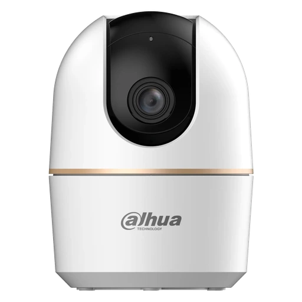
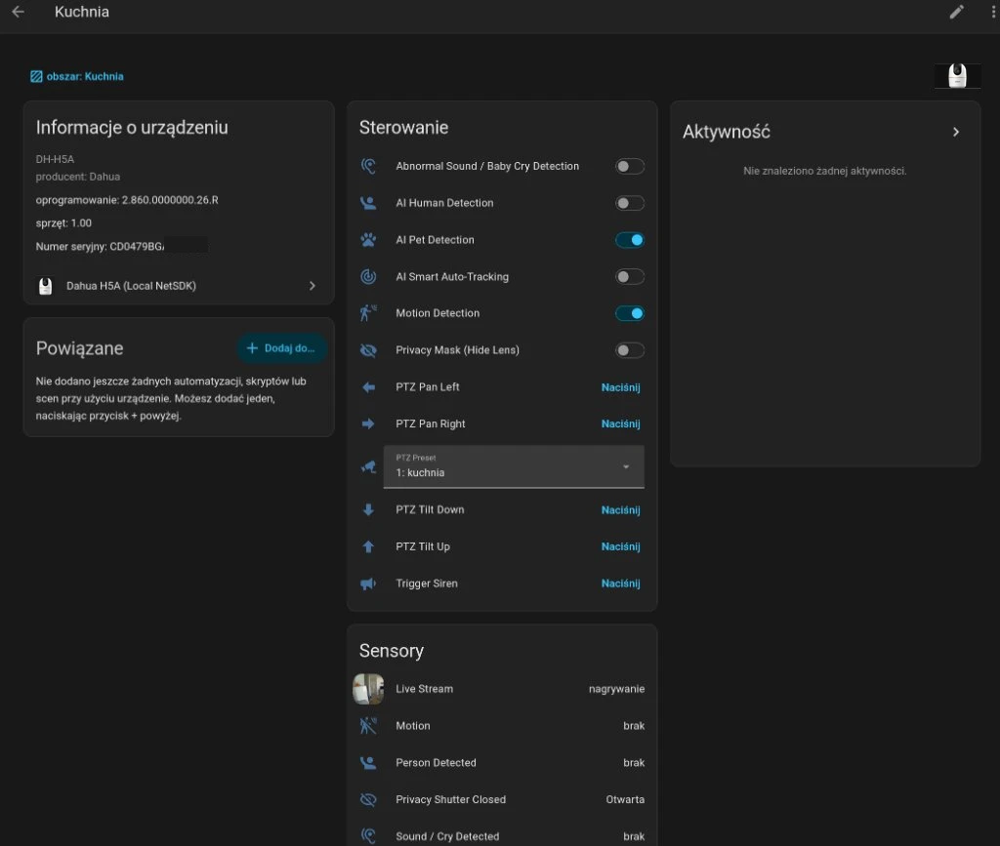

# open-dahua-h5a (`aio-dahua-h5a` & Home Assistant HACS Integration)

<p align="center">
  
</p>

<p align="center">
  <a href="https://github.com/wojciehm/open-dahua-h5a/releases"></a>
  <a href="https://github.com/wojciehm/open-dahua-h5a/actions/workflows/validate.yaml"></a>
  <a href="https://github.com/hacs/integration"></a>
  <a href="https://www.home-assistant.io/"></a>
  
  <a href="#supported-languages--community-translations"></a>
  <a href="LICENSE"></a>
</p>

Clean-room, dependency-free **Home Assistant Custom Integration (`custom_components/dahua_h5a`)**, **async Python library (`aio_dahua_h5a`)**, and **CLI (`dahua-h5a`)** for 100% local control of **Dahua H5A 5MP 360° Indoor Wi-Fi 6 (`DH-H5A` / `IPC-H5A`)** and Hero-series cameras over **TCP Port `37777` (NetSDK DVR2 `0xa0` + Embedded JSON-RPC `0xf6`)** and **RTSP Port `554`**.

> **Legal & Interoperability Notice (EU Directive 2009/24/EC Art. 6 & § 69e UrhG):**  
> This clean-room open-source project was created **solely for interoperability**—enabling legal owners of Dahua H5A / Hero-series cameras to integrate their own hardware with open-source smart home systems (**Home Assistant**) on a local network, in accordance with **Article 6 of EU Directive 2009/24/EC** and **§ 69e of the German Copyright Act (UrhG)**.  
> - **No circumvention of security or access controls:** Valid administrator credentials (`username` and `password`) for the device are strictly required.  
> - **Zero vendor code:** This repository contains **no** proprietary Dahua SDK libraries, binary blobs, or firmware files—only an independent Python `asyncio` implementation built from scratch by **Google Antigravity (Gemini 4 Argon High)**.  
> - **No affiliation:** Not affiliated with, endorsed by, or supported by Dahua Technology.

---

## Why Port `37777` Instead of HTTP Port `80`?

On the consumer/IoT **Dahua H5A (`DH-H5A`)**, firmware `V2.860.0000000.26.R` explicitly disables the legacy HTTP Web UI and `/cgi-bin/*.cgi` API (`"DeviceWebCaps": {"SupportLocalWebSource": false, "SupportWebService": false}`). Port `80` only runs an embedded `gSOAP/2.8` ONVIF endpoint, while **Port `37777`** exposes the complete JSON-RPC control plane encapsulated inside 32-byte DVR2 binary frames (`0xa0` login + `0xf6` JSON-RPC).

See [`docs/PROTOCOL_SPEC.md`](docs/PROTOCOL_SPEC.md) for the full byte-level specification, including the `DH_Superencipherment` Base62 password hash and `0xf6` frame reassembly rules, and [`docs/h5a_capabilities.json`](docs/h5a_capabilities.json) for the complete camera capability and RPC method dump.

---

## Home Assistant Integration (HACS — Multi-Camera UI Workflow)

[](https://my.home-assistant.io/redirect/hacs_repository/?owner=wojciehm&repository=open-dahua-h5a&category=integration)

The repository is structured as a ready-to-install **HACS Integration** (`custom_components/dahua_h5a` + `hacs.json`) with a full UI `ConfigFlow` (no YAML or static files required):

1. Open **HACS** in Home Assistant -> **Custom repositories** -> add `https://github.com/wojciehm/open-dahua-h5a` with category **Integration**.
2. Click **Download** and restart Home Assistant.
3. Go to **Settings -> Devices & Services -> Add Integration** and search for **Dahua H5A (Local NetSDK)**.
4. Enter your camera's **IP / Hostname**, **NetSDK Port (`37777`)**, **RTSP Port (`554`)**, **Username (`admin`)**, and **Password**.
5. Repeat **Add Integration** for as many cameras as you have—each camera is uniquely identified by its hardware serial number (`magicBox.getSerialNo`) and maintains its own isolated TCP `37777` connection and real-time event stream.

### Exposed Home Assistant Entities (per camera)



- **Camera**: 5MP H.265 Live Stream (`subtype=0`) or Sub Stream (`subtype=1`), RTSP JPEG Snapshots, Turn On/Off mapped to physical Privacy Shutter, plus entity services (`dahua_h5a.ptz_move`, `dahua_h5a.ptz_goto_preset`, `dahua_h5a.ptz_set_preset`, `dahua_h5a.ptz_remove_preset`, `dahua_h5a.trigger_siren`).
- **Switches (10)**: Privacy Mask (Hide Lens), AI Human Detection, AI Pet Detection, AI Smart Auto-Tracking, Motion Detection, Abnormal Sound / Baby Cry Detection, Status Indicator LED, Stream Audio Recording, Image Mirror, Image Flip (180° Ceiling Mount).
- **Selects (2)**: Night Vision IR Mode (`auto` / `off` / `on`), Dynamic PTZ Preset Selector.
- **Numbers (3)**: Speaker Volume (`0–100%`), Microphone Sensitivity (`0–100%`), Sound Detection Sensitivity (`1–100%`).
- **Buttons (6)**: PTZ Up, PTZ Down, PTZ Left, PTZ Right, Trigger Siren, Calibrate PTZ.
- **Binary Sensors (4)**: Motion (`VideoMotion`), Person Detected (`SmartMotionHuman`), Sound / Cry Detected (`AudioMutation` / `BabyCry`), Privacy Shutter Closed.
- **Sensors (5)**: MicroSD Card Status, MicroSD Used (`%`), MicroSD Free Space (`GB`), PTZ Pan Angle, PTZ Tilt Angle.

---

## Supported Camera Features

| Feature | Port `37777` RPC / Config Table | CLI Subcommand (`odh`) |
| :--- | :--- | :--- |
| **Privacy Mode (Physical Lens Mask)** | `AELensMask` (`Status: true/false`) | `odh privacy [on\|off]` |
| **AI Human Detection** | `SmartMotionDetect` (`ObjectTypes.Human`) | `odh human-detect [on\|off]` |
| **AI Pet / Animal Detection** | `SmartMotionDetect` (`ObjectTypes.Animal`) | `odh pet-detect [on\|off]` |
| **Smart Auto-Tracking (PTZ)** | `SmartMotionDetect` (`SmartTrack`) | `odh smart-track [on\|off]` |
| **Motion Detection & Sensitivity** | `MotionDetect` + `SmartMotionDetect` (`Low`/`Middle`/`High`) | `odh motion-detect [on\|off] [--sensitivity ...]` |
| **Abnormal Sound / Baby Cry Detection** | `AudioDetect` (`Enable`, `AnomalyDetect`, `AnomalySensitive`) | `odh audio-detect [on\|off] [--sensitivity 1..100]` |
| **Front Status Indicator LED** | `LightGlobal` (`Enable`) | `odh led [on\|off]` |
| **Night Vision & ICR Filter** | `Lighting` (`Auto`/`Manual`/`Off`) + `VideoInDayNight` (`Brightness`/`Color`/`BlackWhite`) | `odh night-vision [auto\|night\|day]` |
| **Image 180° Flip & Horizontal Mirror** | `VideoInOptions` + `VideoImageControl` | `odh flip [on\|off]`, `odh mirror [on\|off]` |
| **Mic / Speaker Volume & Denoise** | `AudioInputVolume`, `AudioOutputVolume`, `AudioInDenoise`, `Encode` | `odh volume [--mic N] [--speaker N] [--denoise on\|off]` |
| **Built-in Siren / Audio Alarm** | `CoaxialControlIO` + `speak` + `Sound` | `odh siren [status\|on\|off] [--duration S] [--volume N]` |
| **PTZ Pan / Tilt / Presets / Calibration** | `ptz.factory.instance` -> `ptz.start`, `ptz.stop`, `ptz.gotoPreset`, `ptz.restartPtz` | `odh ptz <up\|down\|left\|right\|preset\|calibrate>` |
| **MicroSD Storage Telemetry** | `storage.getDeviceAllInfo` | `odh storage` |
| **Real-Time Event Stream** | `eventManager.attach` -> `client.notifyEventStream` & `eventManager.getEventIndexes` | `odh events` |
| **5MP RTSP Snapshot & Streams** | `rtsp://<host>:554/cam/realmonitor?channel=1&subtype=0\|1` | `odh snapshot -o snap.jpg` |

---

## Standalone Python Library & CLI Installation

```bash
uv venv .venv
uv pip install --python .venv/bin/python -e ".[dev]"
```

---

## CLI Usage (`odh` / `dahua-h5a`)

> **Note:** The CLI binary is available as **`odh`** (Open Dahua) or **`dahua-h5a`**. Both commands accept identical flags and subcommands.

```bash
# Hardware, firmware, and RTSP URLs
odh info

# Complete camera state (privacy, AI, LED, night vision, volumes, PTZ, MicroSD, active alarms)
odh status

# Toggle Privacy Mode (physical lens mask)
odh privacy on
odh privacy off

# Toggle AI Human / Pet Detection & Auto-Tracking
odh human-detect on
odh pet-detect on
odh smart-track on

# Status LED & Night Vision
odh led off
odh night-vision auto

# PTZ Control & Presets
odh presets
odh ptz left --speed 4 --duration 0.35
odh ptz preset --index 1

# Capture 5MP JPEG Snapshot via RTSP
odh snapshot -o snapshot.jpg

# Subscribe to real-time motion / human / pet / cry events
odh events
```

---

## Python Async API Usage

```python
import asyncio
from aio_dahua_h5a import DahuaH5AClient


async def main() -> None:
    async with DahuaH5AClient(
        host="172.16.60.46",
        username="admin",
        password="...",
    ) as cam:
        info = await cam.get_device_info()
        print(f"Connected to {info.device_type} ({info.machine_name}) FW {info.software_version}")

        state = await cam.get_full_state()
        print("Privacy Mode:", state.privacy_mode)
        print("PTZ Position:", state.ptz.pan, state.ptz.tilt)
        print("SD Card Used %:", state.storage.used_percent)


asyncio.run(main())
```

---

## Supported Languages & Community Translations

The Home Assistant integration includes native UI translations (`custom_components/dahua_h5a/translations/`) for **12 languages**:

- 🇬🇧 English (`en.json`)
- 🇵🇱 Polski (`pl.json`)
- 🇩🇪 Deutsch (`de.json`)
- 🇪🇸 Español (`es.json`)
- 🇫🇷 Français (`fr.json`)
- 🇮🇹 Italiano (`it.json`)
- 🇳🇱 Nederlands (`nl.json`)
- 🇵🇹 Português (`pt.json`)
- 🇨🇿 Čeština (`cs.json`)
- 🇺🇦 Українська (`uk.json`)
- 🇯🇵 日本語 (`ja.json`)
- 🇨🇳 简体中文 (`zh-Hans.json`)

### Contributing a New Translation
1. Copy `custom_components/dahua_h5a/translations/en.json` to `custom_components/dahua_h5a/translations/<lang>.json` (using a standard BCP-47 / ISO 639-1 language code supported by Home Assistant).
2. Translate the string values while keeping all JSON keys identical to `strings.json`.
3. Run `.venv/bin/pytest -v` to verify key parity across all translation files and open a Pull Request.

---

## Running Tests

```bash
.venv/bin/pytest -v
```
